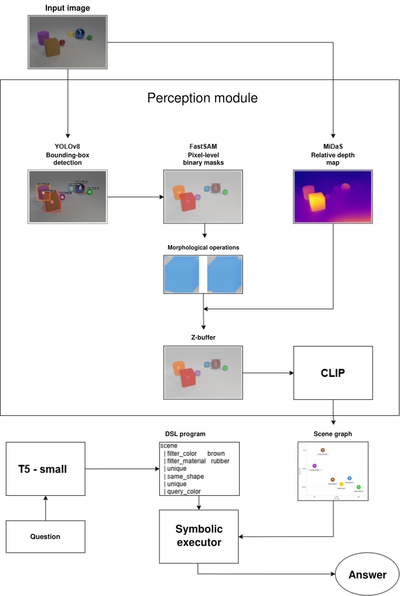
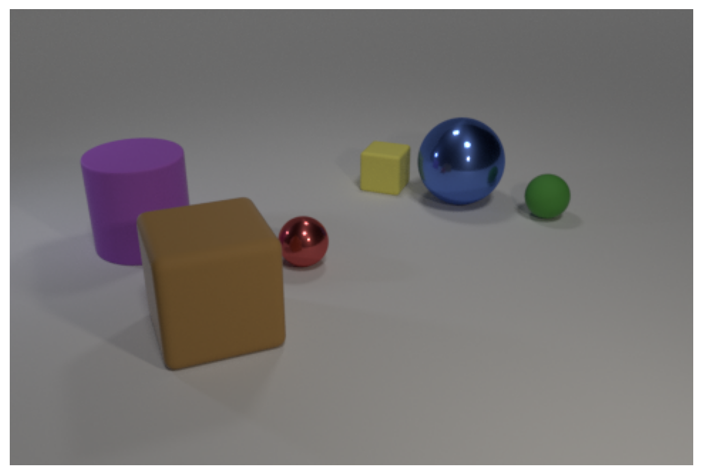
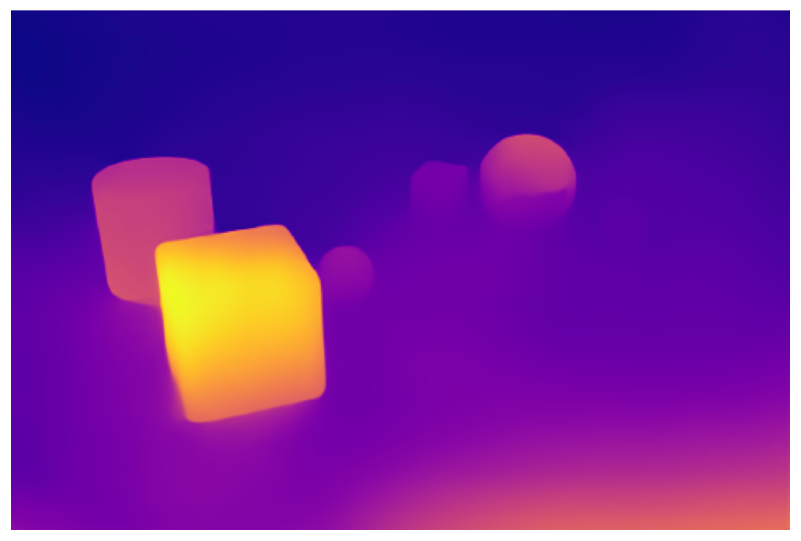
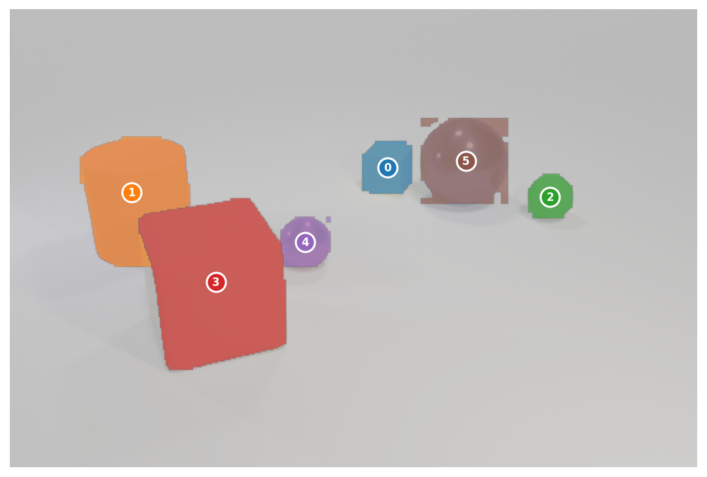
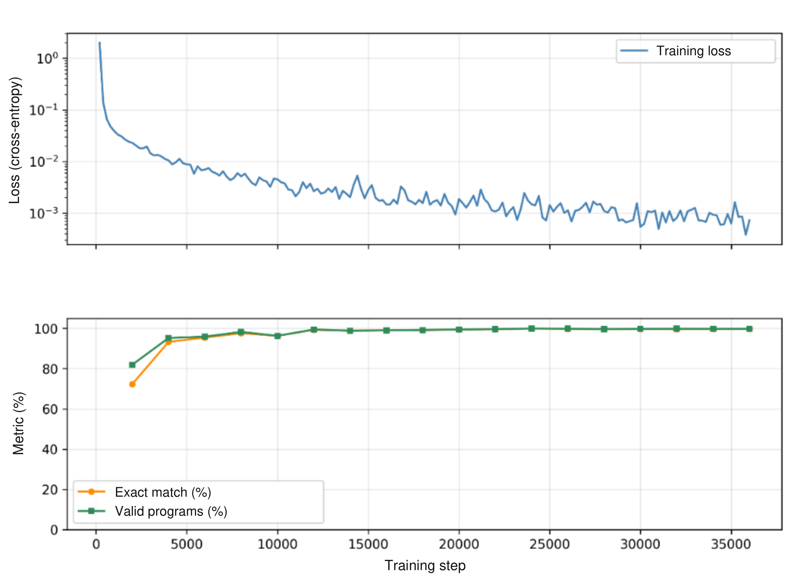

# Neuro-Symbolic Visual Question Answering

*Visual Scene Understanding through Neuro-Symbolic Reasoning*  
Bachelor's thesis by Bogdan Đukić, University of Novi Sad, Faculty of Technical Sciences, 2026.  
Supervisor: Prof. Dr. Milan Segedinac.

A visual question answering system built around an explicit scene representation and executable reasoning programs. The perception module extracts objects, attributes, and spatial relations from an image. T5-small translates a question into a domain-specific language (DSL), and a symbolic executor evaluates the resulting program over the scene graph.

The thesis evaluates this approach on CLEVR, CLEVR-CoGenT, and CLEVR-Humans. The experiments separate errors in visual perception from errors in question translation, and examine REINFORCE adaptation to human-written questions.

## Thesis, project overview and presentations

Read the full thesis or the one-page summary, or download the defense slides below.

| Document | Format | Language |
| :--- | :--- | :--- |
| [Read the full bachelor's thesis (77 pages)](docs/presentation/DIPLOMSKI_RAD_BOGDAN_PDF_JUL.pdf) | PDF | Serbian (Cyrillic) |
| [Read the one-page project summary](docs/one-page-summary.pdf) | PDF | English |
| [Download the defense presentation](docs/presentation/Bachelor_Thesis_Presentation_EN.pptx) | PowerPoint | English |
| [Download the original defense presentation](docs/presentation/DIPLOMSKI-PPT.pptx) | PowerPoint | Serbian |

## Results

Answer accuracy reported in the [Serbian thesis](docs/presentation/DIPLOMSKI_RAD_BOGDAN_PDF_JUL.pdf), Tables 6.2 and 6.8. The experiments ran on Kaggle and Colab. Final Kaggle output files were not retained; [thesis_reported.json](results/thesis_reported.json) records the values and their source.

| Dataset | Ground-truth graph | End-to-end | Perception gap |
| :--- | ---: | ---: | ---: |
| CLEVR validation | 99.9% | 79.0% | 20.9 pp |
| CLEVR-CoGenT valB | 99.7% | 79.0% | 20.7 pp |
| CLEVR-Humans, before RL | 41.4% | 32.7% | 8.7 pp |
| CLEVR-Humans, after RL | 57.1% | 45.6% | 11.5 pp |

**Ground-truth evaluation** supplies the annotated scene graph and measures question translation plus symbolic execution. **End-to-end evaluation** builds the graph from the image and includes perception errors. The gap is the difference in reported accuracy, in percentage points.

REINFORCE improves accuracy on human-written questions by 15.7 percentage points with annotated graphs and 12.9 points end-to-end, using answer supervision without Humans program annotations. On CLEVR, the 20.9-point gap between the two evaluation tracks shows the effect of perception errors on otherwise accurate symbolic reasoning.

## Method

<p align="center">
  <a href="docs/assets/thesis_architecture_en.png"></a>
</p>

*Figure 1. System architecture, translated from thesis Figure 4.1 (p. 20). The original layout and intermediate images are preserved. [Editable SVG](docs/assets/thesis_architecture_en.svg).*

### Image to scene graph

The perception pipeline assembles a structured description of the image:

| Stage | Component | Output |
| :--- | :--- | :--- |
| Object localization | YOLOv8 with FastSAM proposals | Bounding boxes and confidence scores |
| Instance segmentation | FastSAM on object crops | Binary masks refined with morphological operations |
| Depth estimation | MiDaS | Relative inverse-depth map and object depth statistics |
| Overlap resolution | Depth-ordered mask assignment | Masks with overlapping pixels resolved |
| Attribute extraction | CLIP plus geometric heuristics | Color, shape, material, and size |
| Spatial reasoning | Pairwise geometric rules | `left`, `right`, `front`, and `behind` adjacency lists |

| Input image | Relative inverse depth | Masks after overlap resolution |
| :---: | :---: | :---: |
|  |  |  |

Saved outputs from the thesis-illustration notebook. Brighter depth values indicate nearer surfaces. Color, shape, and material use CLIP; size uses a geometric heuristic.

The scene graph exposes two fields:

```python
{
    "objects": [
        {
            "color": "cyan", "shape": "sphere",
            "material": "rubber", "size": "small",
            "bbox": [x1, y1, x2, y2],
            "pixel_coords": [center_x, center_y, inverse_depth]
        },
        # Additional objects...
    ],
    "relationships": {
        "left": [...], "right": [...],
        "front": [...], "behind": [...]
    }
}
```

`relationships[relation][i]` contains the indices of objects in that relation **to object `i`**. For example, `behind[3] = [2]` means object 2 is behind object 3.

### Question to program

T5-small is fine-tuned on CLEVR question/program pairs. Programs are serialized as operations separated by `|`. A sequential operation consumes the previous result; branches refer to earlier steps explicitly, such as `count:2` or `equal_integer:3,7`.

The shared inference implementation generates five beam candidates. Each candidate is parsed and checked for valid operators, backward references, input/output types, and permitted attribute values. The first valid program is passed to the executor.

| DSL group | Operators | Role |
| :--- | :--- | :--- |
| Scene | `scene` | Retrieve all objects |
| Filters | `filter_color`, `filter_shape`, `filter_size`, `filter_material` | Select objects by attribute |
| Relations | `relate` | Follow a spatial relation |
| Sets | `intersect`, `union`, `unique` | Combine sets or select an object |
| Queries | `query_color`, `query_shape`, `query_size`, `query_material` | Read an object's attribute |
| Counting and existence | `count`, `exist` | Produce an integer or Boolean |
| Comparisons | `equal_color`, `equal_shape`, `equal_size`, `equal_material`, `equal_integer`, `less_than`, `greater_than` | Compare attributes or counts |
| Matching attributes | `same_color`, `same_shape`, `same_size`, `same_material` | Find other objects sharing an attribute |

The language contains 27 operators and four types: `ObjectSet`, `Integer`, `Bool`, and `Attribute`. The vocabulary covers eight colors, three shapes, two sizes, two materials, and four spatial directions.

### Program to answer

For the question used in the defense presentation:

> What color is the cube behind the cyan sphere?

the reasoning program is:

```text
scene | filter_color cyan | filter_shape sphere | unique |
relate behind | filter_shape cube | unique | query_color
```

| Step | Operation | Interpretation |
| ---: | :--- | :--- |
| 0 | `scene` | Start with every object |
| 1 | `filter_color cyan` | Keep cyan objects |
| 2 | `filter_shape sphere` | Keep cyan spheres |
| 3 | `unique` | Select the reference sphere |
| 4 | `relate behind` | Find objects behind it |
| 5 | `filter_shape cube` | Keep cubes in that region |
| 6 | `unique` | Select the target cube |
| 7 | `query_color` | Return **blue** |

The executor stores each intermediate result and exposes an execution trace. Boolean results are normalized to `yes` or `no`.

Run a small, manually specified version of this example with **no model downloads or datasets**:

```bash
python -m examples.reasoning_demo
```

## Experiments

### Question translation and natural-language adaptation

| Dataset / checkpoint | Questions in GT evaluation | Answer accuracy | Valid programs | Execution failures |
| :--- | ---: | ---: | ---: | ---: |
| CLEVR validation | 1,000 | 99.9% | 100.0% | 0.0% |
| CoGenT valB | 5,000 | 99.7% | 100.0% | 0.1% |
| CLEVR-Humans before RL | 7,202 | 41.4% | 90.5% | 25.5% |
| CLEVR-Humans after RL | 7,202 | 57.1% | 92.6% | 0.6% |

Source: thesis Table 6.2 and presentation slide 13. Rates are rounded as reported. Formal program validity does not imply that a program expresses the intended question.

The CLEVR model uses supervised sequence learning. The Humans experiment samples programs and rewards their execution results over annotated scenes. The RL scripts use a separate sequential interpreter and a different input convention from the shared inference module; see [the experiment guide](experiments/README.md).

| Training setting | CLEVR supervised learning | CLEVR-Humans REINFORCE |
| :--- | :--- | :--- |
| Initial model | T5-small | CLEVR-trained checkpoint |
| Supervision | Question/program pairs | Questions, answers, and annotated scenes |
| Learning rate | `5e-4` | `8e-6` |
| Input limit | 64 tokens | 64 tokens |
| Output limit | 128 tokens | 96 generated tokens |
| Batch | 16 examples | 4 questions, 4 samples each |
| Additional settings | Weight decay 0.01, 500 warmup steps | Temperature 1.1, KL coefficient 0.05 |
| Training environment | Google Colab, NVIDIA T4 | Kaggle, NVIDIA T4 |

The supervised run ended after 36,000 steps, approximately 0.823 epochs, when the Colab session reached its time limit. The script configures three epochs; the retained Trainer history records the completed portion.

<p align="center">
  <a href="docs/assets/thesis_training_en.png"></a>
</p>

*Figure 2. T5-small training on CLEVR, from thesis Figure 6.1 (p. 48). Only the axis and legend labels have been translated; the original curves and scales are unchanged. [Editable SVG](docs/assets/thesis_training_en.svg).*

### Perception diagnostics

The thesis evaluates perception on 1,000 CLEVR validation images, matching detected objects to annotated objects by their image-plane centers.

| Detection metric | Reported value |
| :--- | ---: |
| Recall | 97.5% |
| Precision | 88.7% |
| F1 | 92.9% |
| Exact object count | 53.0% |
| False negatives per image | 0.16 |
| False positives per image | 0.80 |

| Attribute | Accuracy | Spatial relation | Reported score |
| :--- | ---: | :--- | ---: |
| Color | 87.8% | Left | 66.5% |
| Shape | 95.5% | Right | 66.7% |
| Material | 94.4% | Front | 68.6% |
| Size | 92.8% | Behind | 44.3% |
| | | Overall relations | 61.5% |

Source: thesis Tables 6.4, 6.5 and 6.7; presentation slide 14. Attribute scores concern matched objects. Relation scores depend on the aggregation method used in each evaluation script; these values follow the thesis protocol.

Color accuracy ranges from 97% for green to 71% for brown. Spatial relations also remain a source of error, particularly `behind` at 44.3%.

### Relation to earlier work

The architecture follows the separation of scene perception, question parsing, and execution studied in [IEP](https://cs.stanford.edu/people/jcjohns/iep/) and [NS-VQA](https://github.com/kexinyi/ns-vqa). This implementation uses T5 for program generation and a modular perception pipeline with CLIP attribute classification.

| Dataset | IEP | NS-VQA | This thesis, E2E | This thesis, GT |
| :--- | ---: | ---: | ---: | ---: |
| CLEVR | 96.9% | 99.8% | 79.0% | 99.9% |
| CoGenT B | 73.7% | 63.9% | 79.0% | 99.7% |
| CLEVR-Humans | 66.6% | 67.0% | 45.6% | 57.1% |

This table reproduces thesis Table 6.9 and presentation slide 16 for context. Training data, adaptation protocols, and evaluation subsets differ. In particular, this project's T5 is trained on standard CLEVR; this is not the restricted CoGenT-A training protocol. GT scores also bypass image perception and are not directly comparable to image-based systems.

## Repository layout

```text
configs/                Reference configuration; current defaults live in Python
converters/             Dataset conversion and evaluation-image sampling
dataset_analysis/       Dataset exploration notebooks and operator analysis
docs/
  one-page-summary.pdf  English project summary
  assets/               Translated thesis figures and original notebook outputs
  presentation/         Original and English defense presentations
dsl/                    Types, operators, validator, scene graph, executor
eval/                   Answer evaluation, perception diagnostics, error analysis
examples/               Model-free symbolic reasoning example
experiments/
  colab/                Supervised T5 training and detected-graph evaluation
  kaggle/               Detector training, Humans adaptation, cloud evaluation
nl2dsl/                 Shared inference, serialization, data preparation, LLM tools
perception/             Detection, segmentation, depth, and attribute modules
report/                 Thesis illustration notebook
requirements/           Lightweight, development, and API dependencies
results/                Transcribed final thesis results and provenance
scene_graph/            Graph construction, spatial relations, visualization
tests/                  DSL and scene-graph tests
```

Datasets, model weights, checkpoints, generated evaluation records, and local thesis drafts are excluded from Git.

## Installation

Use Python 3.10 to 3.12 for the research workflows. The thesis used Python 3.10; lightweight checks have also been run with Python 3.12. GPU training requires a compatible PyTorch/CUDA installation.

```bash
python -m venv .venv
```

Activate it with `.venv\Scripts\Activate.ps1` on Windows PowerShell or `source .venv/bin/activate` on Linux/macOS.

For the full perception, T5, and notebook dependencies:

```bash
python -m pip install -r requirements.txt
```

The requirements include the original OpenAI CLIP package from GitHub, so Git must be installed. FastSAM is imported through Ultralytics. Dependency versions are specified as ranges; the original cloud environments do not have a lockfile.

For symbolic tests and graph utilities without the neural models:

```bash
python -m pip install -r requirements/dev.txt
python -m examples.reasoning_demo
python -m pytest -m "not slow and not clevr and not clevr_full" -q
```

## Data and model preparation

Download [CLEVR and CoGenT](https://cs.stanford.edu/people/jcjohns/clevr/) and [CLEVR-Humans](https://cs.stanford.edu/people/jcjohns/iep/) from their project pages. Keep the data locally in this layout:

```text
datasets/
  clevr/
    images/train/       images/val/
    questions/          scenes/
  cogent/
    images/valB/        questions/          scenes/
  clevr_humans/
    CLEVR-Humans-train.json
    CLEVR-Humans-val.json
```

Run the converters from the repository root:

```bash
python -m converters.convert_clevr
python -m converters.convert_cogent
python -m converters.convert_humans
python -m nl2dsl.prepare_data
```

The converters write unified records under `datasets/converted/`; T5 preparation writes question/program TSV files under `datasets/nl2dsl/`. Each record joins a question, answer, image path, scene graph, and available program annotation. CLEVR-Humans has no reference programs. The current Humans converter handles the validation split; RL uses the original training JSON and matching CLEVR training scenes directly.

Place the supervised T5 checkpoint in `models/t5-nl2dsl-final/`, including its tokenizer and configuration. Fine-tuned checkpoints are not bundled with Git. The cloud scripts contain the training procedures and their original runtime paths.

For perception, explicitly supply the intended detector checkpoint:

```python
from perception.detector import HybridDetector
from scene_graph.builder import SceneGraphBuilder

detector = HybridDetector(yolo_model_path="models/yolov8m_clevr.pt")
builder = SceneGraphBuilder(detector=detector)
graph, intermediates = builder.build("path/to/image.png", return_intermediates=True)
```

The default detector path is `models/yolov8m.pt`, which may resolve to generic pretrained weights. It does not automatically select the CLEVR fine-tuned checkpoint. MiDaS and CLIP may download pretrained weights on first use.

## Evaluation and experiments

Evaluate the supervised T5 checkpoint using annotated scene graphs:

```bash
python -m eval.run_eval --dataset clevr_val --track gt --limit 1000 --model models/t5-nl2dsl-final --output results/runs/clevr_baseline
python -m eval.run_eval --dataset cogent_b --track gt --limit 5000 --model models/t5-nl2dsl-final --output results/runs/cogent_baseline
python -m eval.run_eval --dataset clevr_humans --track gt --model models/t5-nl2dsl-final --output results/runs/humans_baseline
```

`--track detected` builds scene graphs from the JSONL image paths. It requires images and perception weights and uses the current Python defaults. Use the Kaggle scripts for the original cloud workflows; consult [experiments/README.md](experiments/README.md) before selecting a checkpoint or interpreter.

Evaluation writes a summary, per-question records, and a resumable checkpoint. Use a **separate output directory for every model and configuration**. Checkpoints identify questions rather than model weights, so reusing an output path across experiments can mix results.

Useful entry points include:

| Task | Entry point |
| :--- | :--- |
| Supervised CLEVR T5 training | `experiments/colab/train_nl2dsl.py` |
| CLEVR YOLO fine-tuning | `experiments/kaggle/yolo_finetune.py` |
| Humans REINFORCE training | `experiments/kaggle/rl_humans.py` |
| Evaluation with the RL interpreter | `experiments/kaggle/humans_val_eval.py` |
| Detected-graph cloud evaluation | `experiments/kaggle/detected_eval.py` |
| Perception breakdown | `experiments/kaggle/perception_breakdown.py` |
| Scene-graph diagnostics | `python -m scene_graph.validate_sg --n 100` |
| Attribute-only diagnostics | `python -m eval.attribute_eval --n 200` |
| Heuristic DSL coverage | `python -m eval.dsl_coverage --jsonl datasets/converted/clevr_humans/clevr_humans_val.jsonl --coverage_only` |

API-based paraphrase and pseudo-label experiments are optional. They require `requirements/api.txt` and an `ANTHROPIC_API_KEY` environment variable. `.env.example` documents the variable; scripts read the process environment. These scripts send questions to an external API when explicitly run.

## Notebooks and figures

| Notebook | Contents |
| :--- | :--- |
| [Perception demo](perception/perception_demo.ipynb) | Detection, inverse depth, and instance masks |
| [Perception pipeline](perception/perception_pipeline.ipynb) | Component comparisons and attribute inspection |
| [Scene graph demo](scene_graph/scene_graph_demo.ipynb) | Graph visualization and comparison with annotated objects |
| [Thesis illustrations](report/figure_4_1_materials.ipynb) | Perception figures and program-step visualization |
| [CLEVR exploration](dataset_analysis/clevr_exploration.ipynb) | Questions, answers, objects, and dataset statistics |
| [GQA exploration](dataset_analysis/gqa_exploration.ipynb) | Exploratory analysis outside the main CLEVR experiments |

Notebook outputs are cleared for version control. Selected outputs are preserved under `docs/assets/source/`. The architecture and training figures above come directly from the Serbian thesis, with English labels supplied in editable SVG files and PNG exports. Both defense presentations are retained unchanged.

[Figure sources](docs/assets/README.md) records the thesis page numbers, original files, and translation details.

## Scope and limitations

The implemented DSL covers CLEVR-style attributes, sets, counting, comparisons, and four spatial directions. Superlatives, arbitrary object categories, `between`, and frequency-based selection require additional operators. The DSL coverage classifier uses lexical rules and is a diagnostic estimate rather than a proof of expressibility.

The current implementation includes a bounding-box fallback for `unique`, HSV color correction, a position-dependent size threshold, and a bounding-box-bottom proxy for front/behind relations. These choices differ from parts of the thesis methodology. Reproducing the reported results requires matching the experiment's checkpoint, interpreter, and perception settings.

GQA and Super-CLEVR conversion utilities are retained as exploratory work. Their schemas and attribute vocabularies are not fully supported by the CLEVR executor. They are outside the main result tables.

Future work includes a dedicated color classifier, improved spatial relation estimation, broader DSL coverage, and adaptation to more varied natural-language questions.

## References and attribution

* Johnson et al. [CLEVR: A Diagnostic Dataset for Compositional Language and Elementary Visual Reasoning](https://cs.stanford.edu/people/jcjohns/clevr/), CVPR 2017.
* Johnson et al. [Inferring and Executing Programs for Visual Reasoning](https://cs.stanford.edu/people/jcjohns/iep/), ICCV 2017. Source of CLEVR-Humans.
* Yi et al. [Neural-Symbolic VQA](https://github.com/kexinyi/ns-vqa), NeurIPS 2018.
* [OpenAI CLIP](https://github.com/openai/CLIP) and [MiDaS](https://github.com/isl-org/MiDaS) provide the pretrained attribute and depth models.

CLEVR example imagery is credited to its dataset authors and distributed under CC BY 4.0, as specified on the [CLEVR project page](https://cs.stanford.edu/people/jcjohns/clevr/). Model weights and third-party datasets retain their own terms. No project-wide software license has been selected in this repository.
